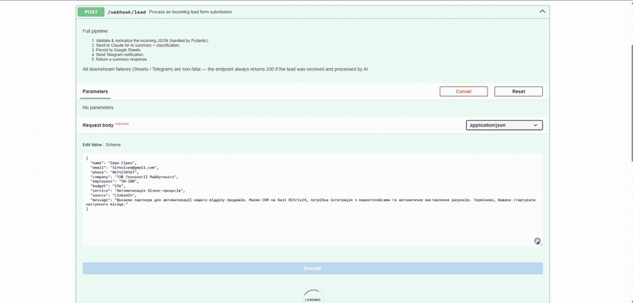

**English** | [Українська](README.uk.md)

# Lead Processor

A FastAPI service that takes a landing-page enquiry by webhook and, within seconds, hands a
sales manager something they can work with: normalised contacts, an AI-written summary of the
enquiry and a lead score, 🔥 HOT / 🟡 WARM / ❄️ COLD. The result goes to Airtable and to
Telegram in parallel.



*The request goes through `POST /webhook/lead`, the bot sends the lead card, and the same
record appears as a row in the Airtable table. The chat list in the recording is blurred on
purpose.*

---

## What happens to an enquiry

```
POST /webhook/lead
       │
       ▼
┌─────────────────────┐
│  Validation and     │  Pydantic: name, email, phone,
│  normalisation      │  budget, source
└──────────┬──────────┘
           │
           ▼
┌─────────────────────┐
│   AI analysis       │  Groq · llama-3.3-70b-versatile
│                     │  summary + HOT / WARM / COLD + reason
└──────────┬──────────┘
           │
     ┌─────┴─────┐   (in parallel, asyncio.gather)
     ▼           ▼
┌──────────┐ ┌──────────┐
│ Airtable │ │ Telegram │
└──────────┘ └──────────┘
```

Stack: **FastAPI + Pydantic v2**, **Groq** (`llama-3.3-70b-versatile`), **Airtable REST API v0**,
**Telegram Bot API**. All outside calls go through `httpx`, no SDKs.

---

## Three decisions worth explaining

**Everything after the AI step is non-fatal.** If Airtable or Telegram is unavailable, the
endpoint still returns `200`, and the `destinations` field shows where the lead actually got
to. The reasoning is simple: the enquiry has already been received and processed, and losing it
to a notification outage is a worse failure than quietly not sending a message. Errors go to
the log; the lead is not lost.

**Airtable and Telegram run in parallel** through `asyncio.gather(..., return_exceptions=True)`;
in sequence it would be two network round trips one after another on every enquiry.

**Classification has a rule-based fallback.** If `GROQ_API_KEY` is not set or the call fails,
`_fallback_analysis()` computes a simple score from the presence of a budget, a company, a phone
number and the message length. The score is rougher, but the enquiry still arrives labelled
instead of failing with an error.

---

## Run

```bash
python -m venv .venv
.venv/Scripts/activate          # Linux/macOS: source .venv/bin/activate
pip install -r requirements.txt

cp .env.example .env            # fill in the keys
python main.py                  # http://localhost:8000
```

Interactive docs: `http://localhost:8000/docs`.

### Environment variables

| Variable | Required | Why |
|---|---|---|
| `GROQ_API_KEY` | no¹ | A [Groq](https://console.groq.com/keys) key: free, 14 400 requests/day, no card |
| `AIRTABLE_API_TOKEN` | no² | Personal Access Token, [create one](https://airtable.com/create/tokens) with the `data.records:write` scope |
| `AIRTABLE_BASE_ID` | no² | Base id, like `appXXXXXXXXXXXXXX` |
| `AIRTABLE_TABLE_ID` | no² | Table id, `tblXXXXXXXXXXXXXX`, or its name |
| `TELEGRAM_BOT_TOKEN` | no² | A token from [@BotFather](https://t.me/BotFather) |
| `TELEGRAM_CHAT_ID` | no² | Chat or channel id (a channel id starts with `-100`) |
| `PORT` | no | Server port, default `8000` |

¹ Without the key the service does not fail: rule-based classification takes over.
² Without these variables the corresponding step is skipped with a warning in the log.

The Airtable table must have the columns: `Lead ID`, `Received At`, `Name`, `Email`, `Phone`,
`Company`, `Employees`, `Budget`, `Service`, `Source`, `Message`, `Classification`,
`Classification Reason`, `AI Summary`.

Keys come only from `.env` / the environment and never reach the repository.

---

## Endpoints

| Method | Path | What it does |
|---|---|---|
| `POST` | `/webhook/lead` | Process an enquiry |
| `GET` | `/health` | Liveness check, `{"status": "ok"}` |
| `GET` | `/docs` | Swagger UI |

### Check

```bash
curl -X POST http://localhost:8000/webhook/lead \
  -H "Content-Type: application/json" \
  -d @test_payload.json
```

### Example response

```json
{
  "success": true,
  "lead_id": "A1401D91",
  "received_at": "2026-06-11 10:48 UTC",
  "classification": "🔥 HOT",
  "ai_summary": "Іван Сірко з ТОВ Технології Майбутнього (50-200 employees) шукає партнера для автоматизації відділу продажів. Потрібна інтеграція Bitrix24 з маркетплейсами та автоматичне виставлення рахунків. Бюджет 15000, старт наступного місяця.",
  "destinations": {
    "airtable": true,
    "telegram": true
  }
}
```

The summary is in Ukrainian because the enquiries are.

---

## Normalisation

Forms send whatever a person typed. `models.py` tidies it up before the data goes further:

| Field | Input | After normalisation |
|---|---|---|
| `name` | `"  іванов петро  "` | `"Іванов Петро"` |
| `email` | `"Petro@EXAMPLE.COM"` | `"petro@example.com"` |
| `phone` | `"(067) 123-45-67"` | `"+380671234567"` |
| `budget` | `"15k"`, `"$5,000"`, `"до 10 000 грн"` | `"15000"`, `"5000"`, `"10000"` |
| `source` | `"LinkedIn"`, `"friend"` | `"social"`, `"referral"` |

A 10-digit phone number starting with `0` is treated as Ukrainian and expanded to `+380…`. A
budget that cannot be reduced to a number stays as it is: better to pass the manager the raw
string than an invented figure.

## Classification

| Score | Criteria |
|---|---|
| 🔥 **HOT** | Large budget, a company, a specific request, urgency |
| 🟡 **WARM** | Signs of interest, but incomplete data |
| ❄️ **COLD** | No budget, a vague request, probably a student or researcher |

The model answers with JSON of three fields (`summary`, `classification`, `reason`); markdown
fences, if they appear anyway, are stripped before `json.loads`.

---

## Limits

This is an MVP, and here is what it deliberately leaves open:

- **The webhook is not authenticated.** Anyone who knows the URL can send enquiries.
  Production needs a shared secret in a header or a signature from the form.
- **No tests.** The most useful ones would cover the normalisation in `models.py`: it is purely
  deterministic and nothing needs mocking.
- **No retries and no queue.** If Airtable returns 500, the record is simply lost: it reaches the
  log, but nobody replays it. The next step is to queue failed records and retry them.
- **The budget currency is lost.** `"$5,000"` and `"5000 грн"` both become `"5000"`. While all
  enquiries are in one currency it does not matter; later it will.
- **`lead_id` is `uuid4[:8]`.** 8 hex characters; at tens of thousands of enquiries a collision
  becomes real.

---

## Structure

```
main.py             FastAPI app, endpoints, pipeline orchestration
models.py           Pydantic: LeadRequest (normalisation) + ProcessedLead
ai_service.py       Groq: prompt, JSON parsing, rule-based fallback
airtable.py         Writing a row to Airtable through the REST API
telegram.py         Formatting and sending the HTML message to Telegram
test_payload.json   An example enquiry for testing
docs/demo.gif       Recording of the service
```

## Deploy

There is no image here: it is a plain ASGI app started with `uvicorn main:app`. The port is read
from the `PORT` variable, so it fits platforms that set it themselves (Render, Railway, Fly.io).
The Python version is pinned in `runtime.txt` and `.python-version` to 3.11.9.

Secrets are set as environment variables on the platform side, not in a `.env` file.
